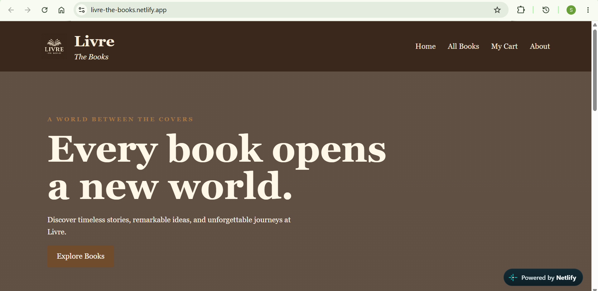
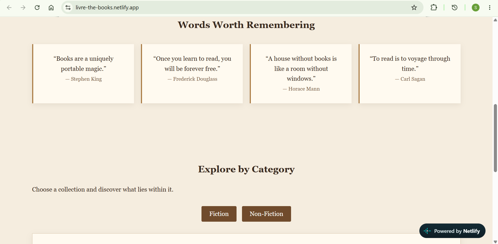
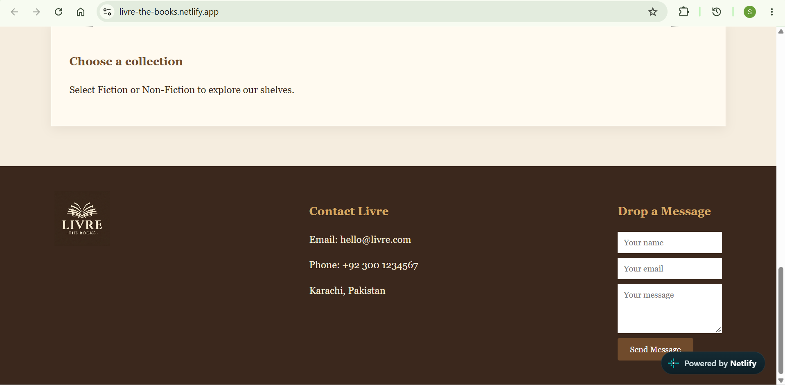
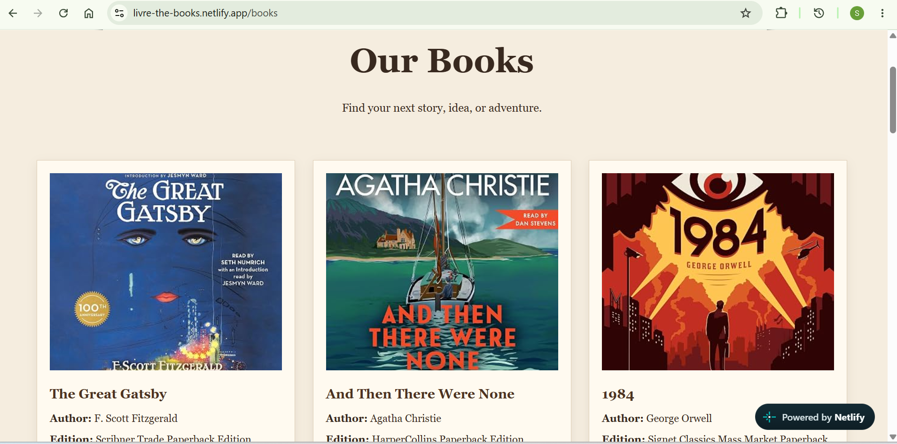

# Livre — The Books

**Livre** is a simple, responsive library/bookstore website built entirely with **HTML, CSS, and vanilla JavaScript**.

## Features

* 📚 Browse 12 featured books
* 🛒 Add books to a shopping cart
* ➕ Add multiple copies of the same book
* 💰 Prices displayed in Pakistani Rupees (PKR)
* 💾 Cart saved using `localStorage`
* 🧾 Simple checkout process
* 📖 Fiction and Non-Fiction category descriptions
* 📱 Responsive design for desktop and mobile
* ✉️ Simple contact/message form
* 🏛️ Warm, traditional library-inspired design

## Pages

* `home.html` — Homepage, quotes, categories, and contact section
* `books.html` — Collection of available books
* `cart.html` — Shopping cart and checkout
* `about.html` — About Livre and contact information

## Files

```text
Livre/
├── home.html
├── books.html
├── cart.html
├── about.html
├── style.css
├── main.js
├── logo.jpg
└── images
    └── book1.jpg ... book12.jpg
```

## Technologies

* HTML5
* CSS3
* JavaScript
* Browser `localStorage`

## Customization

To add your own book covers, replace:

```html

```

with your desired image file.

Book names, authors, editions, genres, descriptions, and prices can be edited directly in `books.html`.

## Running the Website

No server or installation is required.

Simply open:

```text
index.html
```

in a web browser.

## Deployed link

https://livre-the-books.netlify.app/








## Note

This is a **front-end-only project**. Orders are simulated using JavaScript and are not sent to a real database or payment system.

**Livre — Read. Discover. Belong.**

